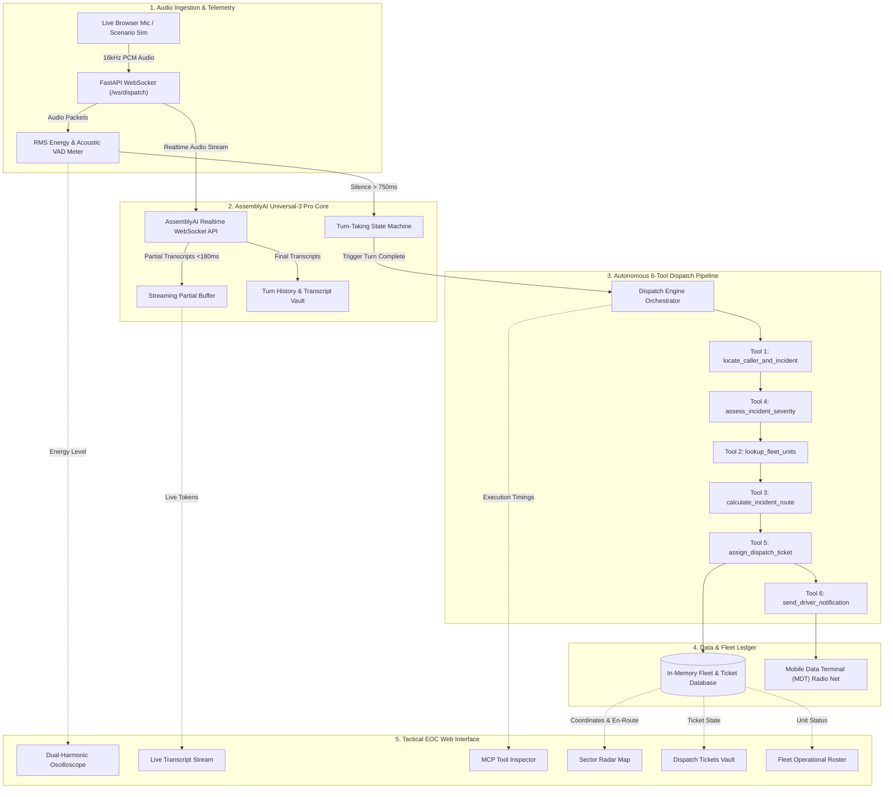

# OmniDispatch: Autonomous Emergency & Fleet Logistics Voice Agent

[](https://www.python.org/downloads/)
[](https://fastapi.tiangolo.com)
[](https://www.assemblyai.com/)
[](https://react.dev/)
[](https://tailwindcss.com/)
[](tests/)
[](LICENSE)

> Built for the **Lablab.ai AssemblyAI Voice Agent Hackathon ($10,000 Prize Pool, September 2026)**.  
> **OmniDispatch** is a mission-critical, autonomous emergency dispatch and fleet logistics voice agent. Powered by **AssemblyAI Universal-3 Pro Realtime STT**, acoustic Voice Activity Detection (VAD) turn-taking, and a deterministic 6-tool routing pipeline, OmniDispatch shaves response initiation from 180 seconds down to sub-second execution.

---

## Table of Contents

- [The Problem](#the-problem)
- [The OmniDispatch Solution](#the-omnidispatch-solution)
- [System Architecture](#system-architecture)
- [Autonomous 6-Tool Dispatch Suite](#autonomous-6-tool-dispatch-suite)
- [Tactical Emergency Operations Center (EOC) UI](#tactical-emergency-operations-center-eoc-ui)
- [3 High-Stakes Emergency Scenarios](#3-high-stakes-emergency-scenarios)
- [Quick Start Guide](#quick-start-guide)
  - [Prerequisites](#prerequisites)
  - [Option A: Python Virtualenv & Node (Local Dev)](#option-a-python-virtualenv--node-local-dev)
  - [Option B: Docker Compose (Single Command)](#option-b-docker-compose-single-command)
- [REST API & WebSocket Reference](#rest-api--websocket-reference)
- [Environment Configuration](#environment-configuration)
- [Automated Testing & Verification](#automated-testing--verification)
- [License](#license)

---

## The Problem

Emergency 911 dispatch centers, hazardous material containment authorities, and cold-chain pharma logistics networks face critical bottlenecks during catastrophic events:

1. **Acoustic Duress & Noisy Channels:** Callers report disasters through blaring sirens, howling blizzard winds, shattering glass, and heavy background engine static. Traditional STT engines choke, introducing hallucinations or high word error rates.
2. **Cognitive Overload & Operator Fatigue:** Dispatchers must simultaneously soothe hysterical callers, transcribe coordinates, look up hazmat evacuation placards, query CAD (Computer-Aided Dispatch) databases, and calculate unit distances.
3. **Fatal Dispatch Latency:** The average manual 911 call takes **90 to 180 seconds** before a dispatch ticket is confirmed and emergency crews receive radio tone-outs. In chemical spills, flash fires, or sub-zero cryogenic failures, 180 seconds is the margin between containment and tragedy.

---

## The OmniDispatch Solution

**OmniDispatch** eliminates manual dispatch lag by placing an autonomous voice agent directly on the front line:

- **AssemblyAI Universal-3 Pro Realtime WebSocket STT:** Processes raw 16kHz linear PCM audio streams with sub-180ms partial transcription latency and industry-leading noise robustness against emergency radio static.
- **Acoustic Energy & VAD Turn-Taking:** Continuous RMS energy calculation coupled with a configurable 750ms silence window allows natural human turn-taking without awkward push-to-talk delays.
- **Autonomous 6-Tool Deterministic Pipeline:** Immediately upon caller turn completion, OmniDispatch orchestrates a cascade of 6 specialized tools in parallel/sequence—triangulating location, evaluating severity, selecting optimal fleet assets via Haversine routing, minting immutable dispatch tickets, and broadcasting digital Mobile Data Terminal (MDT) notifications.
- **Tactical EOC Glass Cockpit:** Real-time operators monitor incoming calls with a military-grade dark telemetry interface featuring dual-harmonic oscilloscopes, sector radar maps, tool call execution traces, and fleet status boards.

---

## System Architecture



### Turn-Taking & Autonomous Tool Cascade

```mermaid
sequenceDiagram
    autonumber
    actor Caller as 911 Caller / Field Driver
    participant WS as /ws/dispatch Gateway
    participant AAI as AssemblyAI Universal-3 Pro
    participant VAD as VAD Turn Machine
    participant Engine as Dispatch Engine
    participant Fleet as Fleet Ledger & MDT

    Caller->>WS: Speaks: "Chemical tanker flipped on I-95 Mile 42..."
    WS->>AAI: 16kHz PCM binary stream
    AAI-->>WS: PartialTranscript ("Chemical tanker flipped...")
    WS-->>Caller: Acoustic feedback loop
    Caller->>WS: [Silence > 750ms]
    VAD->>Engine: Caller Turn Complete Detected
    
    rect rgb(20, 25, 45)
        note over Engine, Fleet: Autonomous 6-Tool Deterministic Cascade (<50ms execution)
        Engine->>Engine: Tool 1: locate_caller_and_incident (I-95 MM 42)
        Engine->>Engine: Tool 4: assess_incident_severity (CRITICAL Code-1)
        Engine->>Fleet: Tool 2: lookup_fleet_units (Hazmat-7, Medic-101)
        Engine->>Fleet: Tool 3: calculate_incident_route (ETA: 4.8m)
        Engine->>Fleet: Tool 5: assign_dispatch_ticket (TICK-987A)
        Engine->>Fleet: Tool 6: send_driver_notification (MDT Broadcast)
    end

    Engine-->>WS: Broadcast ticket_created + fleet_updated
    WS-->>Caller: OmniDispatch Voice Agent: "Hazmat-7 and Medic-101 en route. Move 500ft upwind."
```



---

## Autonomous 6-Tool Dispatch Suite

All tools are formatted using OpenAI / AssemblyAI JSON Schema function definitions with strict type contracts:

| # | Tool Name | Purpose | Key Inputs | Key Outputs |
|---|---|---|---|---|
| **1** | `locate_caller_and_incident` | Resolves verbal landmarks, cellular cell-tower IDs, or highway markers to lat/lng coordinates and sector risk zones. | `raw_location_text`, `caller_phone` | Resolved address, `lat`, `lng`, `sector`, `risk_zone`, landmarks |
| **2** | `lookup_fleet_units` | Geospatial radius query filtering emergency units by vehicle class and availability status. | `incident_lat`, `incident_lng`, `unit_types`, `max_distance_miles` | List of candidate units sorted by Haversine distance and estimated ETA |
| **3** | `calculate_incident_route` | Computes siren-priority transit routes, traffic delay multipliers, and realistic ETAs for responding units. | `unit_id`, `incident_lat`, `incident_lng`, `priority_mode` | Distance in miles, `eta_minutes`, primary response corridor, turn-by-turn steps |
| **4** | `assess_incident_severity` | Evaluates reported physical hazards, acoustic stress levels, and trapped personnel to classify response tier. | `incident_description`, `hazards_reported`, `caller_stress_level` | `severity` (`LOW`–`CRITICAL`), incident code, urgency, recommended unit classes, safety protocols |
| **5** | `assign_dispatch_ticket` | Creates an official incident record, updates unit states to `EN_ROUTE`, and commits to the dispatch ledger. | `call_id`, `incident_type`, `severity`, `location`, `assigned_unit_ids`, `description` | Unique `ticket_id`, timestamp, dispatched units roster, immutable audit entry |
| **6** | `send_driver_notification` | Formats and transmits digital MDT packets and synthesized radio tone-out instructions to vehicle cab displays. | `ticket_id`, `unit_id`, `radio_instruction`, `urgency` | `transmission_id`, delivery acknowledgement, MDT payload with target GPS coordinates |

### Tool Schema Example (`locate_caller_and_incident`)

```json
{
  "type": "function",
  "function": {
    "name": "locate_caller_and_incident",
    "description": "Geocodes or triangulates caller cellular/GPS data or spoken landmarks to exact coordinates, sector, and risk zone.",
    "parameters": {
      "type": "object",
      "properties": {
        "raw_location_text": {
          "type": "string",
          "description": "The verbatim location or landmark description spoken by the caller."
        },
        "caller_phone": {
          "type": "string",
          "description": "Caller phone or cellular triangulation ID."
        }
      },
      "required": ["raw_location_text"]
    }
  }
}
```

---

## Tactical Emergency Operations Center (EOC) UI

The OmniDispatch dashboard is engineered for high-stress operation under low-light control room environments:

1. **Acoustic Telemetry & VAD Oscilloscope:**
   - Real-time HTML5 Canvas dual-harmonic waveform visualization.
   - Dynamic decibel level tracking (`-60 dB` to `0 dB`).
   - Visual turn indicators: Caller speaking (Amber pulsing), Agent speaking (Cyan pulsing), and VAD Silence (Emerald).
2. **Universal-3 Pro Streaming Transcript Stream:**
   - Real-time word-by-word streaming bubble with animated typing cursor.
   - Per-turn latency stamps (sub-180ms) and confidence percentages.
   - Distinguishable speaker colorways and avatar badges.
3. **MCP Tool Execution Inspector:**
   - Real-time collapsible execution trace cards showing tool duration in milliseconds.
   - Deep inspection tabs displaying raw JSON arguments and tool return payloads.
   - Interactive schema dictionary detailing the 6 JSON-schema tools.
4. **Tactical Sector Radar & Fleet Positioning Map:**
   - 100x100 SVG coordinate radar grid with concentric 15/30/45-mile perimeter rings.
   - Real-time animated vector paths projecting from responding units to the incident epicenter.
   - Interactive unit markers revealing speed, crew count, capabilities, and radio frequencies on click.
5. **Active Dispatch Tickets Vault:**
   - Live incident cards color-coded by severity (`CRITICAL`, `HIGH`, `MEDIUM`).
   - Associated assigned fleet unit badges and full incident narrative.
6. **Operational Fleet Status Roster:**
   - Live fleet roster displaying unit callsigns, vehicle classifications, home sectors, live status (`AVAILABLE`, `EN_ROUTE`), ETAs, and VHF/UHF tactical frequencies.

---

## 3 High-Stakes Emergency Scenarios

OmniDispatch includes 3 pre-configured scenarios with millisecond-precision audio simulation:

### Scenario 1: Interstate 95 Chemical Tanker Collision
- **Category:** Hazmat & Multi-Vehicle Highway Collision
- **Location:** Interstate 95 Northbound at Mile Marker 42 (Sector: Highway-North)
- **Severity:** `CRITICAL` (Code-1 Hazmat Multi-Agency)
- **Hazards:** Toxic chlorine gas vapor leak (Placard 1017), pinned unconscious motorists, 70mph highway traffic.
- **Units Assigned:** `Hazmat-7` (Mass Decontamination & Vapor Neutralization), `Medic-101` (ALS Trauma Ambulance), `Patrol-204` (Highway Perimeter Lockdown).
- **ETA:** ~4.8 minutes.

### Scenario 2: Pier 44 Industrial Warehouse 3-Alarm Blaze
- **Category:** Commercial Structure Fire & Extrication
- **Location:** Pier 44 Logistics Warehouse, 820 Dock Street (Sector: Industrial-Port)
- **Severity:** `CRITICAL` (3-Alarm Box Alarm)
- **Hazards:** Tier-3 lithium-ion battery thermal runaway, structural roof collapse threat, three workers trapped behind warped Bay 4 roll-down security doors.
- **Units Assigned:** `Engine-4` (1500 GPM Water Pumper), `Ladder-12` (100ft Aerial Platform), `Rescue-3` (Hydraulic Extrication Saws).
- **ETA:** ~3.2 minutes.

### Scenario 3: Alpine Pass Cold-Chain Biologics Rescue
- **Category:** High-Value Pharmaceutical Cryogenic Crisis
- **Location:** Route 9 Alpine Pass, Mile Post 18 Mountain Cut (Sector: Northern-Valley)
- **Severity:** `HIGH` (Priority Cold-Chain Emergency)
- **Hazards:** 20,000 oncology biologics facing thermal degradation (-62°C climbing toward -50°C spoilage threshold), seized carrier engine in whiteout blizzard.
- **Units Assigned:** `ColdChain-09` (-80°C Mobile Deep Freeze Transfer Unit), `Patrol-204` (Plow Escort).
- **ETA:** ~8.9 minutes.

---

## Quick Start Guide

### Prerequisites

- **Python 3.12+**
- **Node.js 20+** and **npm**
- **AssemblyAI API Key** *(Optional: OmniDispatch operates out-of-the-box in zero-config simulation mode with synthesized 16kHz audio if no key is supplied)*.

### Option A: Python Virtualenv & Node (Local Dev)

#### 1. Clone & Set Up Backend

```bash
cd /home/ddso/Projects/omnidispatch-voice-agent

# Create and activate virtual environment
python3 -m venv .venv
source .venv/bin/activate

# Install dependencies
pip install --upgrade pip
pip install -r requirements.txt
```

#### 2. Configure Environment

```bash
cp .env.example .env
# Edit .env to add your AssemblyAI API key (optional):
# ASSEMBLYAI_API_KEY=your_assemblyai_api_key_here
```

#### 3. Build or Run Frontend

```bash
cd frontend
npm install
npm run build
cd ..
```

#### 4. Launch OmniDispatch

```bash
# Start backend server (serves frontend static build on http://localhost:8000)
uvicorn backend.main:app --host 0.0.0.0 --port 8000 --reload
```

*Open your browser to `http://localhost:8000`.*

> **Dual Hot-Reload Mode:** For frontend UI styling, you can run `npm run dev` inside `frontend/` (accessible at `http://localhost:5173`) while the FastAPI backend runs on port 8000.

---

### Option B: Docker Compose (Single Command)

OmniDispatch includes a multi-stage Docker build combining Node 22 Alpine and Python 3.12 Slim:

```bash
# Build and launch container in detached mode
docker-compose up --build -d

# Check container health status
docker-compose ps

# View live application logs
docker-compose logs -f omnidispatch
```

Access the dashboard at `http://localhost:8000`.

To tear down:
```bash
docker-compose down
```

---

## REST API & WebSocket Reference

### WebSocket Endpoint: `/ws/dispatch`

Connect via `ws://localhost:8000/ws/dispatch`.

#### Query Parameters:
- `session_id` *(optional)*: Unique string identifier for voice session.
- `scenario_id` *(optional)*: `scenario-1`, `scenario-2`, `scenario-3`, or `none`.
- `live_mode` *(optional)*: `true` to enable browser microphone live streaming.

#### Incoming Messages (Client to Server):
```json
// Trigger simulated scenario call:
{ "action": "start_scenario", "scenario_id": "scenario-1" }

// Enable live mic streaming:
{ "action": "start_live_mic" }

// Send 16kHz 16-bit linear PCM audio buffer:
// Send binary WebSocket frames (Int16Array bytes)

// Abort active call:
{ "action": "stop_call" }

// Heartbeat:
{ "action": "ping" }
```

#### Outgoing Events (Server to Client):
- `session_started`: Emitted when dispatch session begins.
- `turn_status`: Emits `SPEAKING` or `SILENCE` state with active speaker tag.
- `audio_waveform`: Emits base64 audio slice with RMS energy telemetry for visualizer.
- `transcript_partial`: Realtime streaming partial tokens from AssemblyAI.
- `transcript_final`: Punctuate final utterance turn with latency metrics.
- `tool_start` & `tool_complete`: Tool execution lifecycle with arguments, results, and runtime duration.
- `ticket_created`: Emits newly minted `DispatchTicket`.
- `fleet_updated`: Broadcasts updated status and ETAs of all units.
- `system_notification`: Operator alerts, status warnings, and connection confirmations.

### REST API Endpoints

| Method | Endpoint | Description |
|---|---|---|
| `GET` | `/api/health` | Service health, AssemblyAI connection state, and loaded tool count. |
| `GET` | `/api/fleet` | Lists all 9 operational fleet units with GPS coordinates and capabilities. |
| `GET` | `/api/fleet/{unit_id}` | Detailed telemetry and assigned ticket status for a single unit. |
| `POST` | `/api/fleet/reset` | Resets fleet status and active tickets to initial default state. |
| `GET` | `/api/tickets` | Returns all active and historical emergency dispatch tickets. |
| `GET` | `/api/tickets/{ticket_id}` | Retrieves a single dispatch ticket and full audit trail. |
| `POST` | `/api/tickets` | Manual dispatcher override endpoint to mint emergency tickets. |
| `GET` | `/api/scenarios` | Lists the 3 predefined emergency dispatch scenarios. |
| `GET` | `/api/scenarios/{id}` | Retrieves turns and hazard profiles for a specific scenario. |
| `GET` | `/api/tools` | Returns JSON schema specifications for all 6 dispatch tools. |
| `POST` | `/api/dispatch/tool-execute` | Directly executes any of the 6 tools with arbitrary arguments. |
| `POST` | `/api/dispatch/call` | Programmatically initiates a new voice dispatch session. |

---

## Environment Configuration

Configuration is loaded from environment variables or a local `.env` file via `pydantic-settings`:

| Variable | Default | Description |
|---|---|---|
| `ASSEMBLYAI_API_KEY` | `""` | AssemblyAI API Key. If empty, runs in zero-config high-fidelity simulation mode. |
| `ASSEMBLYAI_REALTIME_URL` | `wss://api.assemblyai.com/v2/realtime/ws` | AssemblyAI Realtime WebSocket API endpoint. |
| `AUDIO_SAMPLE_RATE` | `16000` | Audio sampling frequency in Hz (16kHz recommended for STT). |
| `AUDIO_CHANNELS` | `1` | Audio channel count (Mono). |
| `AUDIO_CHUNK_MS` | `100` | Millisecond duration of streamed audio chunks. |
| `VAD_SILENCE_THRESHOLD_MS` | `750` | Silence duration required to trigger caller turn-end. |
| `VAD_ENERGY_THRESHOLD` | `0.015` | Normalized RMS threshold distinguishing speech from background noise. |
| `AUTO_TOOL_EXECUTION` | `true` | Automatically executes the 6-tool pipeline upon turn completion. |
| `HOST` | `0.0.0.0` | Server bind IP address. |
| `PORT` | `8000` | Server HTTP and WebSocket port. |
| `DEBUG` | `false` | Enables verbose FastAPI debug logging. |

---

## Automated Testing & Verification

OmniDispatch includes a comprehensive pytest test suite covering the API layer, WebSocket lifecycle, AssemblyAI streaming simulator, dispatch tools, and geospatial Haversine fleet routing.

Run all 29 tests:

```bash
source .venv/bin/activate
pytest -v
```

Expected output:
```text
tests/test_api_and_websocket.py::test_api_health PASSED                  [  3%]
tests/test_api_and_websocket.py::test_api_fleet_endpoints PASSED         [  6%]
tests/test_api_and_websocket.py::test_api_fleet_reset PASSED             [ 10%]
tests/test_api_and_websocket.py::test_api_scenarios_endpoints PASSED     [ 13%]
tests/test_api_and_websocket.py::test_api_tools_endpoint PASSED          [ 17%]
tests/test_api_and_websocket.py::test_api_tool_execute_endpoint PASSED   [ 20%]
tests/test_api_and_websocket.py::test_api_create_manual_ticket_and_list PASSED [ 24%]
tests/test_api_and_websocket.py::test_api_dispatch_call_initiate PASSED  [ 27%]
tests/test_api_and_websocket.py::test_websocket_connection_and_ping PASSED [ 31%]
tests/test_assemblyai_stream.py::test_calculate_pcm_energy_silence PASSED [ 34%]
tests/test_assemblyai_stream.py::test_generate_pcm_audio_chunk PASSED    [ 37%]
tests/test_assemblyai_stream.py::test_scenarios_structure PASSED         [ 41%]
tests/test_assemblyai_stream.py::test_get_scenario_by_id PASSED          [ 44%]
tests/test_assemblyai_stream.py::test_assemblyai_simulator_run PASSED    [ 48%]
tests/test_dispatch_tools.py::test_tools_schema_count_and_format PASSED  [ 51%]
tests/test_dispatch_tools.py::test_locate_caller_and_incident_known PASSED [ 55%]
tests/test_dispatch_tools.py::test_locate_caller_and_incident_fallback PASSED [ 58%]
tests/test_dispatch_tools.py::test_lookup_fleet_units PASSED             [ 62%]
tests/test_dispatch_tools.py::test_calculate_incident_route PASSED       [ 65%]
tests/test_dispatch_tools.py::test_assess_incident_severity PASSED       [ 68%]
tests/test_dispatch_tools.py::test_assign_dispatch_ticket PASSED         [ 72%]
tests/test_dispatch_tools.py::test_send_driver_notification PASSED       [ 75%]
tests/test_dispatch_tools.py::test_execute_tool_dynamic PASSED           [ 79%]
tests/test_fleet_engine.py::test_fleet_database_initialization PASSED    [ 82%]
tests/test_fleet_engine.py::test_haversine_distance_calculation PASSED   [ 86%]
tests/test_fleet_engine.py::test_eta_calculation PASSED                  [ 89%]
tests/test_fleet_engine.py::test_dispatch_engine_session_creation PASSED [ 93%]
tests/test_fleet_engine.py::test_dispatch_engine_record_transcript PASSED [ 96%]
tests/test_fleet_engine.py::test_run_autonomous_dispatch_pipeline_end_to_end PASSED [100%]

======================== 29 passed in 1.24s ========================
```

See [TESTING_GUIDE.md](file:///home/ddso/Projects/omnidispatch-voice-agent/TESTING_GUIDE.md) for detailed verification steps, manual walkthroughs, and cURL commands.

---

## License

This project is licensed under the MIT License - see the LICENSE file for details.
